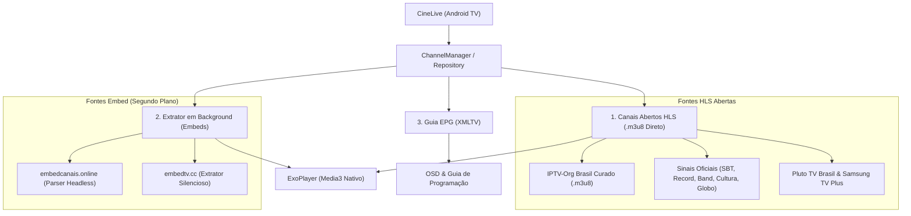

# PLANO DE ARQUITETURA & DESENVOLVIMENTO // APP TV ABERTA (AO VIVO)
**Projeto: CineLive / TV Aberta Nativa para Android TV**  
*Base Tecnológica: Jetpack Compose para TV + ExoPlayer (Media3) + Neo-Brutalismo Técnico*

---

## 1. VISÃO GERAL DO PRODUTO

O **CineLive** será um aplicativo nativo para Android TV / Google TV focado exclusivamente em **Canais de TV Ao Vivo (TV Aberta, Notícias, Esportes e Variedades)**. 

O app reutilizará os componentes maduros, o design system Neo-Brutalista e o motor de player de baixa latência do projeto anterior, mas com uma arquitetura desenhada para **Zapping instantâneo**, **Guia de Programação (EPG)** e **zero anúncios**.

### 1.1 Diferenciais em Relação aos Players Comuns
1. **Zero WebViews com anúncios na tela:** Nenhuma propaganda de popup ou banner que trave o controle da TV.
2. **Troca Rápida de Canais (Zapping):** Pressionar `Cima` ou `Baixo` no controle remoto da TV muda de canal em menos de 1 segundo.
3. **Painel Lateral Translúcido (Side Drawer):** Pressionar `Esquerda` enquanto assiste abre a grade de canais e programação sem pausar a transmissão.
4. **Guia EPG em Tempo Real:** Mostra o nome do programa atual, horário de início/término e barra de progresso.

---

## 2. ESTRATÉGIA DE FONTES DE TRANSMISSÃO (ARQUITETURA DUAL)



### 2.1 Camada 1: Streams HLS Oficiais e Comunitários (Prioritária)
- Consumo direto de fluxos `.m3u8` públicos mantidos pelo repositório open-source `iptv-com/iptv` e `iptv-org` (Brasil).
- **Canais inclusos:** Globo (sinais abertos), SBT, Record TV, Band, RedeTV!, TV Cultura, TV Brasil, CNN Brasil, Jovem Pan News, Record News, TV Gazeta, canais legislativos/educativos e grade da Pluto TV.
- **Vantagem:** Estabilidade altíssima, bitrate adaptativo (1080p, 720p, 480p) e zero anúncios.

### 2.2 Camada 2: Extrator Headless de Embeds (`embedcanais` & `embedtv`)
- Para canais especiais (como canais de esportes ou variedades não abertos):
- Um extrator OkHttp / Headless em segundo plano (como o que fizemos no MegaEmbed) consulta a URL do embed, captura dinamicamente a URL pura `.m3u8` e passa direto para o ExoPlayer.
- O usuário **nunca** vê o site feio deles, nunca clica em propaganda e não sofre com travamentos de navegador.

### 2.3 Camada 3: EPG (Eletronic Program Guide)
- Consumo da lista diária oficial `https://raw.githubusercontent.com/iptv-com/epg/main/guides/brazil.xml`.
- Mapeamento automático dos canais pelo ID (`tvg-id`) para exibir: *Nome do Programa*, *Sinopse breve* e *Horário (ex: 20:30 - 21:45)*.

---

## 3. ARQUITETURA DE UI / UX PARA TV (CONTROLE REMOTO)

### 3.1 Tela Principal: Player em Tela Cheia com OSD
- Ao abrir o app, o último canal assistido inicia imediatamente em tela cheia (como ligar uma TV física).
- **Banner OSD (On-Screen Display):** Aparece por 4 segundos ao trocar de canal ou apertar `OK`:
  - Número e Logo do canal.
  - Título do programa em exibição com badge `AO VIVO`.
  - Barra de tempo neo-brutalista indicando quanto do programa já passou.
  - Título do próximo programa.

### 3.2 Painel Lateral Rápido (Apertando `Esquerda` no D-Pad)
- Abre um menu lateral neo-brutalista sobreposto ao vídeo com:
  - **Filtros por Categoria:** `[ TODOS ]`, `[ TV ABERTA ]`, `[ NOTÍCIAS ]`, `[ ESPORTES ]`, `[ FAVORITOS ]`.
  - Lista vertical de canais com logos compactos e nome do programa atual.
  - Navegar pelos canais com `Cima/Baixo` e apertar `OK` para sintonizar instantaneamente.

### 3.3 Zapping Rápido
- Pressionar `Cima` no controle -> Sintoniza o próximo canal.
- Pressionar `Baixo` no controle -> Sintoniza o canal anterior.
- Pressionar `Voltar` -> Se o menu lateral estiver aberto, fecha o menu. Se estiver em tela cheia, exibe confirmação para sair.

---

## 4. ESTRUTURA DE DIRETÓRIOS DO NOVO APP

Criaremos uma nova pasta de projeto isolada chamada `tv-aberta/`:

```
tv-aberta/
├── app/
│   ├── build.gradle.kts
│   └── src/main/
│       ├── AndroidManifest.xml
│       └── java/com/pedro/cinelive/
│           ├── CineLiveApp.kt               # Application class
│           ├── MainActivity.kt              # Atividade TV em tela cheia
│           ├── data/
│           │   ├── api/
│           │   │   ├── PlaylistService.kt   # Parser e download das listas .m3u/.m3u8
│           │   │   ├── EpgService.kt        # Parser do guia XMLTV (brazil.xml)
│           │   │   └── EmbedLiveExtractor.kt# Extrator de fallback (embedcanais / embedtv)
│           │   ├── local/
│           │   │   ├── ChannelPreferences.kt# Último canal assistido e favoritos
│           │   │   └── DefaultChannels.kt   # Grade de canais offline embutida (fallback seguro)
│           │   └── model/
│           │       ├── ChannelItem.kt       # id, name, logoUrl, streamUrl, category, tvgId
│           │       └── ProgramGuide.kt      # title, startMs, endMs, description
│           ├── ui/
│           │   ├── components/
│           │   │   └── LiveComponents.kt    # ChannelCard, OsdOverlay, CategoryTabs
│           │   ├── screens/
│           │   │   ├── LivePlayerScreen.kt  # Tela única integrada (Player + OSD + Drawer)
│           │   │   └── LiveViewModel.kt     # Gerenciamento de estado, zapping e EPG
│           │   └── theme/                   # Neo-Brutalismo (amarelo neon #D5E022, navy #0B0F19)
├── build.gradle.kts
└── settings.gradle.kts
```

---

## 5. CRONOGRAMA DE IMPLEMENTAÇÃO EM 4 ETAPAS

1. **Etapa 1: Estrutura Base & Modelos:**
   - Criação da pasta `tv-aberta/` com arquivos de configuração Gradle e manifesto para Android TV.
   - Importação dos temas e componentes neo-brutalistas já validados do CineTV.
2. **Etapa 2: Motor de Canais & Parser HLS:**
   - Criação do `PlaylistService` com suporte a carregamento de lista M3U nacional e canais embutidos de contingência (para abrir mesmo sem internet rápida).
   - Criação do extrator de background para canais que dependam de `embedcanais` ou `embedtv`.
3. **Etapa 3: Player Nativo com Zapping & OSD:**
   - Implementação do `LivePlayerScreen` com ExoPlayer configurado para baixa latência.
   - Controles D-pad de zapping (Cima/Baixo) e menu lateral (Esquerda).
4. **Etapa 4: Integração EPG & Instalação na TV:**
   - Sincronização do guia de programação em tempo real.
   - Compilação do APK, instalação direta na TV TCL via ADB e validação visual completa.
