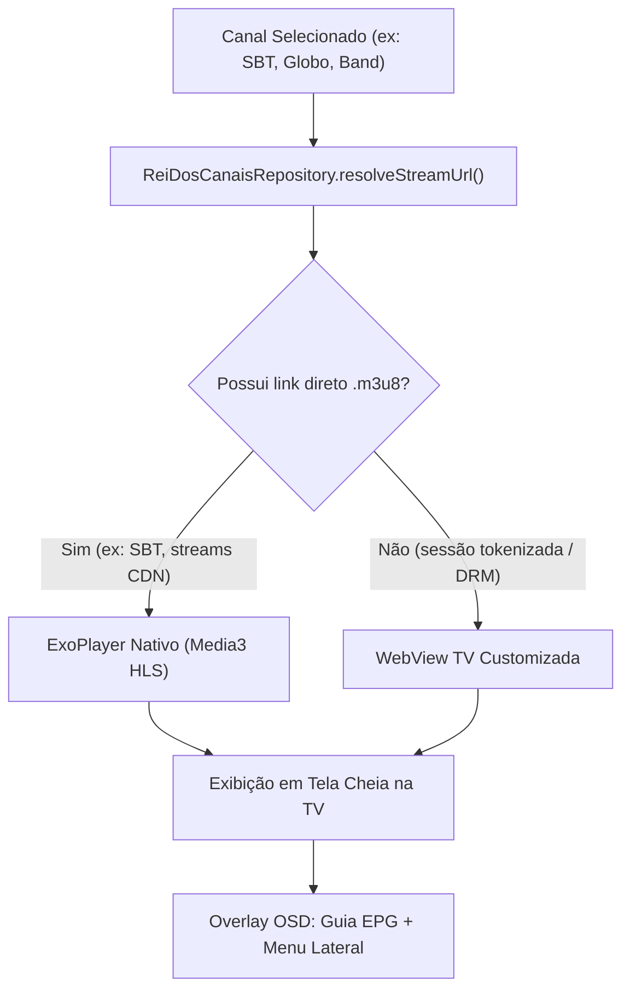

# GUIA MESTRE & PLANO DE IMPLEMENTAÇÃO // APP TV ABERTA (CINELIVE)
**Documento de Instrução para Agentes e Modelos de IA**  
**Data:** 05/11/2026 | **Versão:** 2.0 (Consolidado com API Rei dos Canais)

---

## 1. LOCALIZAÇÃO E ESTRUTURA DO WORKSPACE

O repositório `AppTv` foi reestruturado de forma modular em duas pastas independentes:

```
c:\Users\PC de Pedro\AppTv\
│
├── cinetv/                                # PROJETO 1: Filmes & Séries (On-Demand)
│   ├── app/                               # Código-fonte, recursos e manifesto do CineTV
│   ├── build.gradle.kts                   # Configuração Gradle do CineTV
│   ├── settings.gradle.kts                # Root project: CineTV
│   ├── gradlew.bat                        # Wrapper Gradle funcional
│   ├── local.properties                   # SDK Android e credenciais TMDB (não versionado)
│   ├── ESTILO.md                          # Guia visual Neo-Brutalista
│   └── AUDITORIA_E_MELHORIAS.md           # Roteiro de auditoria e otimização para a IA
│
└── cinelive/                              # PROJETO 2: TV Aberta & Ao Vivo (Live Streaming)
    ├── app/                               # Pasta do aplicativo CineLive (com.pedro.cinelive)
    │   ├── build.gradle.kts               # Configuração do módulo app (Media3, Compose, Retrofit)
    │   └── proguard-rules.pro
    ├── build.gradle.kts                   # Plugins Gradle do CineLive
    ├── settings.gradle.kts                # Root project: CineLive
    ├── gradle/wrapper/                    # Gradle Wrapper 8.3.2 / Gradle 8.4
    ├── gradlew.bat                        # Wrapper para compilação local
    ├── local.properties                   # Aponta para o Android SDK local
    ├── ESTILO.md                          # Guia visual Neo-Brutalista obrigatório
    └── PLANO_APP_TV_ABERTA.md             # ESTE PLANO DETALHADO
```

> **Caminho absoluto do projeto:**  
> `c:\Users\PC de Pedro\AppTv\cinelive`
>
> **Caminho absoluto do plano:**  
> `c:\Users\PC de Pedro\AppTv\cinelive\PLANO_APP_TV_ABERTA.md`
>
> **Caminho absoluto das diretrizes visuais (Design System):**  
> `c:\Users\PC de Pedro\AppTv\cinelive\ESTILO.md`

---

## 2. API ESCOLHIDA: REI DOS CANAIS (`https://api.reidoscanais.my`)

Após testes de validação técnica, descartamos `embedcanais.online` e `embedtv.cc` (que são páginas de iframe infestadas de anúncios sem API pública) e adotamos oficialmente a **API pública do Rei dos Canais**:

- **Base URL:** `https://api.reidoscanais.my/`
- **Autenticação:** Pública (não necessita de API Key ou Token no header).
- **Formatos:** JSON REST nativo, logos em alta definição PNG/WebP, URLs de stream/embed e **EPG completo integrado**.

### 2.1 Endpoints Principais

#### A) Categorias de Canais:
`GET https://api.reidoscanais.my/channels/categories`
```json
{
  "success": true,
  "data": [
    { "id": 7, "name": "Canais Abertos" },
    { "id": 6, "name": "Documentários" },
    { "id": 1, "name": "Entretenimento" },
    { "id": 3, "name": "Esportes" },
    { "id": 4, "name": "Filmes e Séries" },
    { "id": 5, "name": "Infantil" },
    { "id": 2, "name": "Notícias" }
  ],
  "total": 7
}
```

#### B) Lista de Canais por Categoria:
`GET https://api.reidoscanais.my/channels?category=Canais%20Abertos`
Retorna todos os canais da categoria com:
- `id`: slug único (ex: `"band"`, `"globo"`, `"sbt"`, `"record"`, `"tvcultura"`)
- `name`: nome de exibição do canal
- `description`: descrição institucional da emissora
- `logo_url`: URL do logotipo com fundo transparente (`https://logocanais.pics/imagens/tvglobo.png`)
- `embeds`: lista de servidores e afiliados regionais (no caso da Globo, inclui todas as afiliadas: SP, RJ, MG, RS, BA, PE, etc.)
- `epg`:
  - `current`: programa atual (`title`, `description`, `formatted_time`, `start_time`, `end_time`, `image`)
  - `next`: próximo programa (`title`, `description`, `formatted_time`, `start_time`, `end_time`, `image`)

#### C) Eventos Esportivos Ao Vivo:
`GET https://api.reidoscanais.my/sports?status=live`
- Retorna partidas em andamento com times, competição (ex: Brasileirão, Champions League), horário de início, pôster e embeds de transmissão.

---

## 3. ARQUITETURA DO PLAYER HÍBRIDO (EXOPLAYER + WEBVIEW TV)

Para garantir **100% de disponibilidade dos canais** sem anúncios na tela:



1. **ExoPlayer Nativo (Media3 HLS):**
   - Utilizado sempre que houver stream direto `.m3u8` extraído do embed.
   - Baixíssima latência, aceleração por hardware pura e zapping instantâneo.
2. **WebView TV com Ad-Block:**
   - Utilizado para emissoras com player proprietário tokenizado (como Globo e Band).
   - Configurações obrigatórias da WebView para TV:
     - `mediaPlaybackRequiresUserGesture = false` (reprodução automática imediata).
     - `domStorageEnabled = true`, `javaScriptEnabled = true`.
     - `userAgent`: Chrome Desktop/Android TV.
     - `shouldOverrideUrlLoading`: Bloqueia popups, páginas externas e propagandas, permitindo apenas os domínios de mídia dos canais.

---

## 4. EXPERIÊNCIA DE USO NA TV (CONTROLE REMOTO D-PAD)

1. **Ao abrir o app:** Inicia diretamente no último canal assistido em tela cheia (experiência idêntica a ligar um televisor físico).
2. **Troca Rápida de Canais (Zapping):**
   - `D-Pad Cima` / `Channel Up`: Muda imediatamente para o canal anterior.
   - `D-Pad Baixo` / `Channel Down`: Muda imediatamente para o próximo canal.
3. **Banner EPG (OSD):**
   - Aparece por 5 segundos ao mudar de canal ou ao pressionar `D-Pad Direita`.
   - Exibe o logotipo do canal, selo `AO VIVO`, nome do programa atual, horário e próximo programa.
4. **Guia de Canais (Painel Lateral / Drawer):**
   - Ao pressionar `D-Pad Esquerda` ou `OK`, o menu lateral desliza suavemente sobre a transmissão sem pausar o áudio/vídeo.
   - Permite filtrar por categorias (`CANAIS ABERTOS`, `NOTÍCIAS`, `ESPORTES`) e selecionar qualquer canal com `OK`.
5. **Botão Voltar (`Back`):**
   - Se o menu lateral estiver aberto, fecha o menu e foca no vídeo.
   - Se o banner EPG estiver aberto, fecha o banner.
   - Se estiver em tela cheia, exibe diálogo de saída do aplicativo.

---

## 5. DESIGN SYSTEM: NEO-BRUTALISMO TÉCNICO

Todas as telas do CineLive devem seguir rigorosamente o padrão visual de [`ESTILO.md`](file:///c:/Users/PC%20de%20Pedro/AppTv/cinelive/ESTILO.md):
- **Formas:** `RectangleShape` absoluto. Bordas arredondadas (`RoundedCornerShape`) são **estritamente proibidas**.
- **Cores Principais:**
  - `NeoYellow` = `#D5E022` (Amarelo Neon de Alto Contraste para Foco e Destaques).
  - `NeoDark` = `#0B0F19` (Azul/Preto Profundo para Fundo).
  - `NeoSurface` = `#141A29` (Superfície dos Cards e Painéis).
  - `NeoBorder` = `#2A344A` (Bordas de 2dp).
  - `NeoRed` = `#EF4444` (Badge "AO VIVO" e "NO AR").
- **Tipografia:** Sem serifa, peso `Bold` ou `Black`, títulos em caixa alta (`UPPERCASE`).

---

## 6. ROTEIRO DE EXECUÇÃO PASSO A PASSO (PARA O PRÓXIMO AGENTE)

Quando o usuário autorizar a implementação do novo app, o agente deverá seguir estes passos em ordem:

1. **Verificação do Ambiente:**
   - Navegar até `c:\Users\PC de Pedro\AppTv\cinelive`.
   - Garantir que `local.properties` aponta para `C:\Users\PC de Pedro\AppData\Local\Android\Sdk`.
2. **Criação da Camada de Dados (`data/`):**
   - `com.pedro.cinelive.data.model.LiveModels.kt`: Data classes para `CategoryResponse`, `ChannelItem`, `ChannelEmbed`, `ChannelEpg`, `EpgProgram`, `SportsEvent`.
   - `com.pedro.cinelive.data.api.ReiDosCanaisApi.kt`: Interface Retrofit com as anotações `@GET`.
   - `com.pedro.cinelive.data.api.ReiDosCanaisRepository.kt`: Cliente OkHttp configurado + função de resolução de streams `.m3u8`.
3. **Criação do Design System e Componentes (`ui/`):**
   - `ui.theme.Color.kt`, `ui.theme.Dimens.kt`, `ui.theme.Type.kt`, `ui.theme.Theme.kt`.
   - `ui.components.NeoComponents.kt`: `NeoChannelCard`, `NeoCategoryChip`, `NeoEpgBanner`.
4. **Criação da Tela do Player & Controle Remoto:**
   - `ui.screens.live.LiveViewModel.kt`: Carregamento assíncrono de canais, zapping, EPG timer e controle do drawer.
   - `ui.screens.live.LivePlayerScreen.kt`: ExoPlayer + WebView + Drawer lateral + banner EPG + interceptação D-pad.
   - `MainActivity.kt` & `AndroidManifest.xml`: Configuração para Android TV (`LEANBACK_LAUNCHER`, `usesCleartextTraffic="true"`).
5. **Compilação e Instalação na TV:**
   - Executar `.\gradlew.bat assembleDebug` dentro de `cinelive/`.
   - Conectar na TV via ADB (`adb connect 192.168.1.53:5555`).
   - Instalar APK: `adb install -r app\build\outputs\apk\debug\app-debug.apk`.
   - Iniciar o app na TV: `adb shell am start -n com.pedro.cinelive/.MainActivity`.
   - Capturar screenshot via `adb exec-out screencap -p` para auditoria visual.
6. **Commit e Push:**
   - Versionar todas as alterações com mensagens claras e fazer `git push origin main`.
